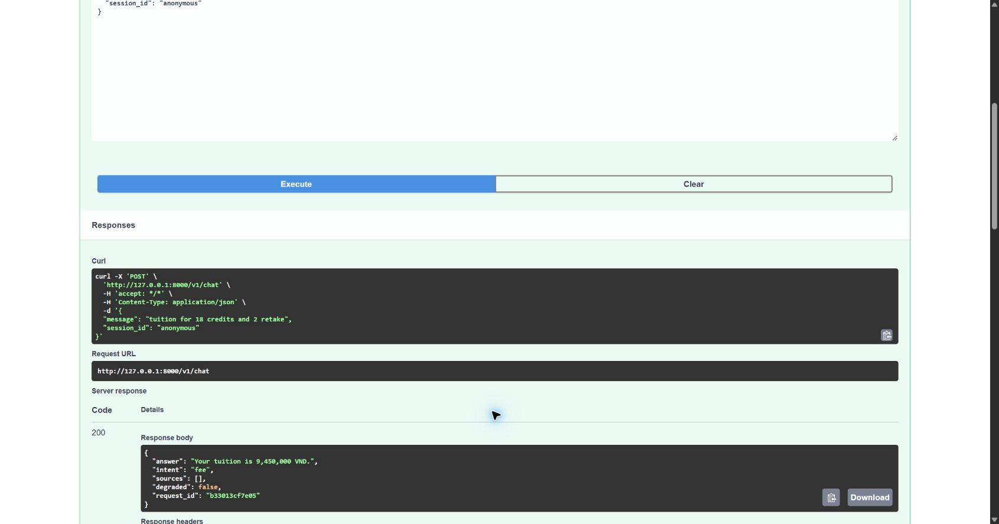

# Lab 4 in-class verification

Completed P1–P5 and T1–T4. Homework H1–H3 and the optional rate limiter are excluded.

Validated on 2026-10-31:

- Warm-up: 5 passed.
- Starter: 23 passed, 1 skipped (optional rate limit).
- Root Lab 3: 239 passed.
- Ruff lint and format checks pass for both packages.
- Provided curl script ran against the real local server; status codes matched
  expectations, including live weather returning 200.
- Swagger `/docs`: POST `/v1/chat` returned 200 and tuition of 9,450,000 VND.

Full curl output: [curl-results.txt](curl-results.txt).

Part E.4: `test_weather_down_returns_503` uses an HTTPX mock transport whose
handler raises `ConnectTimeout`, simulating an unavailable weather provider
without an internet request.

The Lab 4 starter keeps its supplied service implementation and runs separately
from the root Lab 3 package. CI uses separate jobs to avoid mixing their imports.
The Postman collection is an optional alternative to Swagger.
