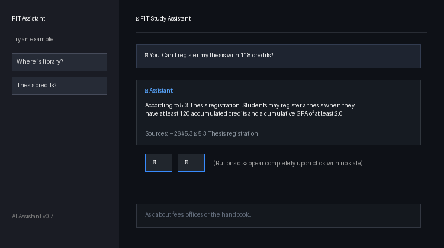
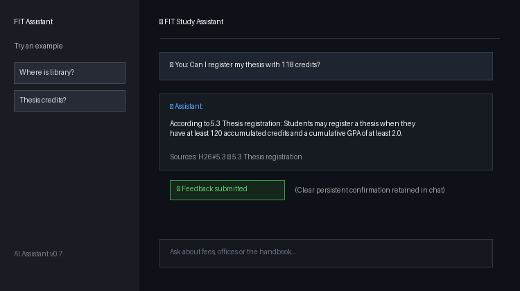

# Lab 7 homework — 10-minute usability test

**Tester (not in your team, first name only)**: Nam  
**Date**: 2026-11-22  
**Task you gave them**: "Find out if you can register your thesis with 118 credits, and where to replace a lost student card."

Rule: do not help or explain. Watch and write down what happens.

| # | What the tester did or said | What they expected | Why the system/UI caused it | Fix idea |
|---|---|---|---|---|
| 1 | Clicked 👍 after getting the thesis answer, watched the brief toast message disappear, and asked: *"Did it actually submit? The buttons just vanished without any confirmation."* | Expected a persistent visual confirmation that their feedback was registered and saved. | The UI removed the 👍/👎 button container once `rid` was added to `st.session_state.rated`, leaving an empty space without state feedback. | Display a persistent `st.caption("✓ Feedback submitted")` when `rid in st.session_state.rated`. |
| 2 | Read the sources line `Sources: S26#3 — 3 Student card replacement` and asked: *"What does S26#3 stand for? Is it a room number or course code?"* | Expected human-readable document descriptions such as "Student Services Guide 2026, Section 3". | The source string outputs internal document IDs (`S26#3`, `H26#5.3`) directly to the user interface. | Format source citations with full descriptive document titles (e.g., `Handbook 2026 §5.3`). |
| 3 | Accidentally hit Enter with empty text and saw the warning *"Please type a question."*, remarking that it looked like a system failure. | Expected empty submits to be silently ignored without throwing warning alerts. | `validate_input()` checks for empty string and renders `st.warning()`. | Demote empty query validation to subtle input helper text or silently ignore empty triggers. |

### The one change we made (commit link):
Commit [`5327476`](https://github.com/MikaelVo639/assistant-core-lab-group04/commit/5327476) — `fix(ui): show feedback confirmation note after rating (H1)`:
Rendered `st.caption("✓ Feedback submitted")` once a response is rated, giving persistent visual confirmation to the user.

### Before / after screenshot:
- **Before fix** (ratings disappear into blank whitespace):  
  
- **After fix** (persistent status confirmation):  
  
