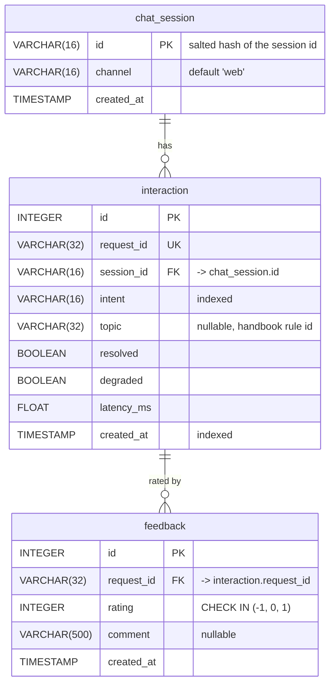

# Data model (Lab 5)

Matches `sql/migrations/001_init.sql` and `src/assistant_api/db.py`.

- One `chat_session` has many `interaction` rows (1:N on `interaction.session_id`).
- One `interaction` has zero or more `feedback` rows (1:N on `feedback.request_id`, which references the
  `UNIQUE` `interaction.request_id`). The API returns 404 when the request id does not exist.
- `faq` (migration 002) is standalone staff content with no foreign keys.
- Nothing personal is stored: no raw message, no name or phone, and the session id is a salted hash.
